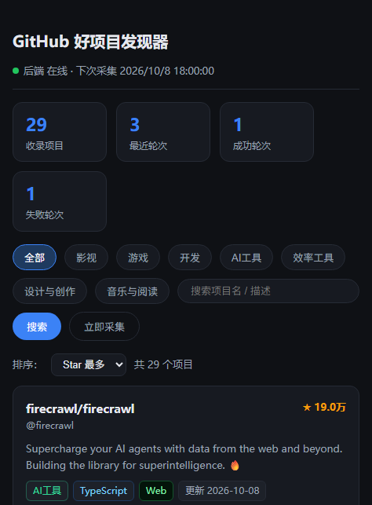
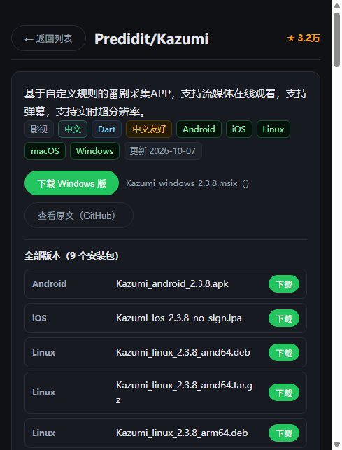

# STARPICK 拾星（StarPick）

一个**生产级**的 GitHub 公开项目自动发现与下载引导工具。每隔数小时自动搜索 GitHub 上高质量、近期活跃、中文友好的开源项目，按 7 大分类整理成可交互榜单，并标注平台支持、系统要求与下载直链，帮你发现值得使用的工具。

> **只想用，不想看技术细节？** 直接去[下载安装包](https://github.com/Geoff-WSX/starpick/releases/latest)（Windows / macOS 双平台，双击安装即可）。

## 这是谁用的？不会 GitHub 也能用

GitHub 上有几十万个免费开源的好工具，但英语界面、命令行方式、真假难辨的质量，把大多数人挡在了门外。**STARPICK 拾星做的是"替你逛 GitHub"**：它自动替你找、替你筛、替你翻译和标注，你只像刷应用商店一样点开、下载、用。

- **不逛 GitHub 的普通用户**：想找个视频下载器/屏幕录制/音乐播放器，不用知道什么是仓库、release、README——打开拾星，按分类浏览，点「直接下载」就一行，完成。
- **不上 GitHub 的人（无代理/访问不稳）**：README、图片、下载直链自动走国内镜像通道加速，大多数环节不用翻墙也能用。
- **怕下到假货的用户**：每个项目都是真实开源仓库，星级、活跃时间、更新历史一目了然，杜绝下载站捆绑安装器的套路。
- **想要新工具的效率党/极客**：每 6 小时自动发现、每日全量扫荡，新出的高星项目自动上架；可自定义分类与关键词，把它调成你自己的「开源雷达」。
- **家长/装机人**：电影、动漫、游戏（含汉化）、学习工具一栏排开，装机选软件直接照单挑。

一句话：**你不需要会 GitHub，只需要会用"下载"这个按钮**——剩下的（发现、质检、翻译、平台标注、找直链）都由拾星完成。

## 功能特性

- **定时自动采集**：默认每 6 小时一轮（可配置），启动自动补跑错过的轮次
- **7 大分类**：影视 / 游戏 / 开发 / AI工具 / 效率工具 / 设计与创作 / 音乐与阅读（配置可增删），每类关键词自动 OR 合并查询，杜绝措辞差异漏检（如「追剧」搜不到、换「番剧」就能命中）；全库 104 个搜索关键词（中英双语覆盖，英文描述项目不遗漏）、每分类全量收录（per_category_top 安全上限默认 100，可调），覆盖广且质量可控
- **跨界项目多分类**：同一项目命中多个分类关键词时自动打多分类标签——主分类固定为最先命中的分类（按配置顺序），附加分类以次要标签展示（卡片与详情页均可见），按任一分类筛选都能命中，后台回填不覆盖已定主分类；例：OpenSpeedy（游戏变速器 / 下载提速）随「效率工具」关键词入库后，再命中「游戏」类词时会自动追加游戏分类
- **三重筛选**：Star ≥ 200 + 90 天内活跃 + 中文友好加权（可配置开关）
- **采集中心独立页面**（/collect，首页仅保留列表浏览）：集中管理采集功能——「立即采集」按钮、进行中进度面板（当前阶段、分类进度 x/7、详情抓取进度条、安装包后台回填计数，每 3 秒轮询）、历史采集轮次表格（轮次 / 时间 / 状态 / 候选 / 新增 / 更新 / 跳过 / 实际采集耗时 / 失败原因）；顶栏导航一键切换首页与采集中心；**手动选择本轮过滤阈值**——Star 门槛（不限制/50/100/200/500/1000）与活跃时间（30/60/90/180 天/不限）下拉可选，不选则用配置默认值，点击「立即采集」生效并记录到轮次 stats；**每分类全量收录**（不再只取 Top10，受 per_category_top 安全上限约束，默认 100 可调）
- **新增项目高亮**：每轮新入库项目卡片显示 **NEW** 角标，筛选区新增「新增」一键只看本轮入库项目（判定口径：最近一轮开始时间之后首次入库）
- **按分类采集 / 更新 + 自定义分类**：采集中心弹窗内「采集分类」与「检查更新」均可指定分类——只采集/只更新选中分类（如仅「影视」），下拉同时列出全部自定义分类；**自定义分类**输入分类名称 + 关键词（逗号分隔）即可只搜该分类，分类自动持久化到首页分类筛选，之后可再次按此分类采集/更新；更新检查同样支持「全库 / 仅某分类」
- **下载引导**：自动识别平台（Windows/macOS/Linux/Android/iOS/Docker/Web）、提取系统要求（内存/磁盘/GPU/运行时），项目无明确要求则不标注；**多版本选择**——点击「直接下载」按当前系统优先弹出该项目的全部安装包列表（如 Kazumi 的 Windows msix/zip、macOS dmg、Android apk 共 9 个版本），不再误下第一个文件；服务启动时自动对存量项目**全库回填** release 安装包（无 Token 时按 GitHub 限流排队补全）；**国内镜像下载加速**——无代理访问 GitHub 时，下载链接自动走国内镜像（gh-proxy.com / ghproxy.net，前缀 + 原始 URL 转发，实测 206 可用），弹窗与详情页每个版本都提供「加速下载」主按钮 + 「原地址」备用按钮，「查看原文」按钮悬停提示网络要求
- **应用内详情页**：点击项目进入站内详情页查看完整 README 原文，不再直接跳 GitHub；GitHub 仅作详情页内的「查看原文」外链。README 抓取三通道 failover（国内镜像 gh-proxy.com/ghproxy.net → raw 直连 → GitHub API 兜底，分支解析用 HEAD 自动跟随默认分支），服务启动自动对缺 README 的存量项目补抓；**项目自带多语言 README（如 README.zh-CN.md / README.en.md）时，详情页提供「原文 / 中文 / English」一键切换**（探测结果全库回填）；**没有自带中文变体的项目不提供「中文」选项**——原文本身以中文为主时，README 直接以「中文」标注展示，杜绝点了「中文」却提示"没有自带中文 README"的矛盾；**README 内图片（Markdown 与 HTML 语法均可）自动走后端下发的镜像前缀，解决 raw 直连被重置导致图片无法显示**；**README 正文内项目自带的「English | 中文」切换链接在站内切换语言，绝不跳转 GitHub**
- **语言筛选**：按项目简介语言把中英文分开——「中文 / 英文」一键切换（简介含中文归为中文），卡片与详情页均标注语言标签，中文用户可直接只看中文项目
- **实时搜索**：输入即搜，无需点击搜索按钮——每输入一个字符自动触发搜索（300ms 防抖合并连续输入，回车立即搜索），输入框右侧提供一键清空按钮；搜索词同样同步到 URL，刷新/分享不丢失
- **筛选状态持久化**：分类 / 语言 / 搜索词 / 排序 / 页码全部同步到 URL，刷新页面、浏览器前进后退、复制分享链接均原样恢复；从详情页返回列表也不丢失筛选条件
- **去重与再推荐**：已推荐项目不重复入库；Star 翻倍时自动重新推荐（release 探测为后台异步，大版本更新判定暂不生效）
- **前后端分离**：FastAPI + SQLite 后端，Vue3 + Vite 前端，仅通过 JSON API 交互
- **STARPICK 拾星品牌**：橙红五角星 + 圆弧托手纯图形 logo，字标 STARPICK（全大写）+ 拾星
- **深空星图暗色 UI（默认）**：深空蓝黑底 + 静态星点辉光 + 星白文字 + 橙红星色强调，卡片/表格/下拉/通知面板全主题变量化；**日/夜一键切换**（顶栏圆形按钮，localStorage 记忆，刷新保持），日间为纸面冷白杂志风；统一顶栏组件（五页共用，导航位置恒定不随激活态漂移）；全部页面统一视觉语言
- **生产级健壮性**：限流令牌队列、分级重试（429/403 按重置等待、5xx 退避）、镜像 failover、防重入原子锁（检查+建轮次一体）、崩溃/重启自动清理遗留运行轮次（防采集永久卡死）、优雅停机、结构化日志、65 项单元/契约测试

## 桌面版安装包（推荐普通用户）

**下载地址：[GitHub Releases 最新版](https://github.com/Geoff-WSX/starpick/releases/latest)** —— 打开后在 Assets 里下载对应平台的文件：

| 平台 | 下载文件 | 说明 |
|------|----------|------|
| Windows 10/11 (x64) | `StarPick-1.1.0-setup.exe` | 双击安装，Per-user 无需管理员 |
| macOS (Apple Silicon, 11+) | `StarPick-1.1.0-arm64.dmg` | 拖入 Applications |

除下载安装包外，也可自行构建（开发者）：macOS `./packaging/macos/build_macos.sh`，Windows 由 CI 自动构建（`.github/workflows/build-windows.yml`）。

- **安装位置 / 双击启动**：Windows 装到 `%LOCALAPPDATA%\Programs\StarPick`（默认 Per-user，无 UAC 弹窗）；macOS 把 .app 拖进 Applications。
- **数据与日志**：macOS 在 `~/Library/Application Support/StarPick/`（配置 config.yaml、数据库 history.db、日志 logs/）；Windows 在 `%APPDATA%\StarPick\`。可用 `STARPICK_DATA_DIR` 环境变量另指。卸载不删数据（Windows 卸载器明确保留）。
- **与开发/服务模式共存**：桌面窗口启动时若发现本机已有 STARPICK 服务（127.0.0.1:8000），直接把既有实例显示进窗口，不会起第二个服务；端口被其它程序占用则自动顺延（8000→8011）。
- **GITHUB_TOKEN**：桌面版同样支持——首次进入界面在「设置」里填入（热生效，存数据目录 `.runtime_token`），或把 `.env` 放进数据目录。
- **首次打开的安全提示**：两者均未签名公证。
  - macOS：右键 → 打开（或 系统设置 → 隐私与安全性 → 仍要打开）；ad-hoc 签名，Gatekeeper 拦截属预期。
  - Windows：SmartScreen 弹「Windows 已保护你的电脑」时点「更多信息 → 仍要运行」。
- **升级检查**：设置 → 关于 → 「立即检查」，或有新版本时自动提示（每 6 小时检查一次）。
- **技术细节**：PyInstaller onedir + pywebview（系统 WebView：macOS WKWebView / Windows WebView2，Win10/11 预装）。下载链接仍由系统浏览器接管；`--selftest` 提供无窗口自检（CI 冒烟/排障用，报告见 selftest-report.txt）。

## 快速开始（macOS）

```bash
./start.sh
```

一键脚本会自动完成：依赖检查与安装（自动创建 backend/.venv）→ 前端构建（如缺失）→ 端口检查 → 启动服务并打开浏览器。

> 本仓库为 macOS 分支（Windows 分支使用 `start.bat`，两份分支独立演进，见 FORK.md）。

或手动启动：

```bash
# 1. 安装后端依赖
cd backend
pip install -r requirements.txt

# 2. 构建前端（首次）
cd ../frontend
npm install
npm run build

# 3. 启动服务
cd ../backend
python -m uvicorn app.main:app --host 127.0.0.1 --port 8000
```

访问 **http://127.0.0.1:8000** 即可使用。





## 配置说明

所有配置集中在 `backend/config.yaml`，修改后重启生效，非法配置会拒绝启动并定位错误项。

| 配置块 | 关键项 | 说明 |
| --- | --- | --- |
| `server` | `host` / `port` | 仅本机访问默认 127.0.0.1:8000 |
| `schedule` | `interval_hours` | 采集频率（默认 6 小时） |
| `github` | `token_env` / `search_rate_per_minute` / `request_timeout` / `retry_max` / `mirror_enabled` / `mirror_prefixes` | 配额、超时、重试、镜像列表（按序 failover） |
| `filter` | `min_stars` / `max_inactive_days` / `zh_weight` / `require_zh` | 筛选阈值 |
| `dedup` | `re_recommend_on_major_update` / `rounds_retention` | 去重策略 |
| `categories` | 分类名 → 关键词列表 | 决定搜索范围，可自由增删 |

### 推荐配置 GITHUB_TOKEN（重要）

未认证模式限流较严（搜索 10 次/分钟、core 请求 60 次/小时），一轮采集约 15-30 分钟（匿名限流排队）。
配置 Token 后自动升级：搜索 30 次/分钟、core 5000 次/小时，一轮全量采集约 3-5 分钟（视分类规模，采集后后台继续探测安装包）。

```bash
# backend/ 目录下复制 .env.example 为 .env 并填入
copy .env.example .env
# 编辑 .env，填入 GITHUB_TOKEN=ghp_xxxxxxxxxxxx
# Token 生成：https://github.com/settings/tokens （勾选 public_repo）
```

Token 仅保存在本机 `.env`（已被 .gitignore 排除），不写入配置文件、不入库。

## API 一览

| 方法 | 路径 | 说明 |
| --- | --- | --- |
| GET | `/health` | 健康检查（含下次采集时间） |
| GET | `/api/projects` | 项目列表（`category` / `keyword` / `lang=zh|en` / `new=new` / `page` / `page_size` / `sort=stars|recent`），新增筛选 `new=new` 只看最近一轮入库项目，每项含 `is_new` 标记；`category` 筛选同时匹配主分类与附加分类，每项含 `categories` 附加分类数组 |
| GET | `/api/projects/{id}` | 项目详情（含 README 原文、项目自带中/英文变体 readme_zh/readme_en 与多平台安装包 assets） |
| GET | `/api/collect/status` | 采集进度快照（阶段 / 分类进度 / 详情抓取 / 安装包回填，前端 3 秒轮询） |
| GET | `/api/rounds?limit=N` | 采集轮次记录 |
| GET | `/api/stats` | 统计（总数/分类收获/轮次状态） |
| POST | `/api/run` | 手动触发一轮采集（防重入） |

## 故障排查

| 现象 | 原因与处理 |
| --- | --- |
| 启动即退出：`配置校验失败` | `config.yaml` 有非法项，报错中会列出具体配置键，修正后重启 |
| 页面打开但无项目 | 前往「采集中心」点击「立即采集」触发首轮，或等待定时采集；采集耗时取决于是否配置 Token |
| 日志显示 `403 rate limit` | 未认证配额耗尽。等待下个整点配额重置，或配置 GITHUB_TOKEN |
| 日志显示 `触发配额上限` | 同上；限流器会自动排队，不会瞬间打满 |
| 详情页 README 为空 | 首次采集尚未完成（README 随本轮入库）；服务启动已自动全库回填补抓，重启后等待数分钟即可 |
| 筛选「中文」结果不全 | 语言按项目简介判定（含中文归为中文）；简介为英文但 README 有中文的项目仍归英文，可在「中文友好」标签上识别 |
| 采集失败但服务正常 | 单轮失败不影响服务；下一轮自动重试，失败原因记录在「采集中心」轮次表 |
| 端口被占用 | `start.bat` 会检测并提示；可修改 `config.yaml` 的 `port` |
| 日志乱码 | 日志文件为 UTF-8，用支持 UTF-8 的编辑器查看；控制台乱码不影响功能 |

日志位置：`logs/kazumi.log`（5MB × 5 轮转，单行 JSON 结构，含时间戳/级别/来源）。

## 架构

```
┌─────────────┐    JSON API    ┌──────────────┐
│  Vue3 前端   │ ────────────▶ │  FastAPI     │
│  (dist 静态) │ ◀──────────── │  (uvicorn)   │
└─────────────┘                └──────┬───────┘
                                      │
                    ┌─────────────────┼───────────────────┐
                    │                 │                   │
              ┌─────▼─────┐    ┌──────▼──────┐    ┌───────▼──────┐
              │ APScheduler│───▶│  Collector  │───▶│   SQLite     │
              │  定时触发   │    │ 采集流水线   │    │ (WAL 模式)   │
              └───────────┘    └──────┬──────┘    └──────────────┘
                                      │
                            ┌─────────▼─────────┐
                            │  GitHub API 客户端 │
                            │ 限流/重试/镜像failover│
                            └───────────────────┘
```

三层单向依赖：采集只写库 → API 只读库 → 前端只调 API。语言标记（zh/en）在入库时按简介判定，用于前端中英文筛选；不引入任何外部依赖。

## 目录结构

```
QuanWangSouSuo/
├── start.sh                # 一键启动（macOS）
├── backend/
│   ├── config.yaml         # 全部可调配置
│   ├── requirements.txt    # 生产依赖
│   ├── .env.example        # Token 模板
│   ├── app/
│   │   ├── main.py         # FastAPI 入口 + 调度 + 静态托管（SPA fallback）
│   │   ├── config.py       # 配置加载与强校验
│   │   ├── db.py           # SQLite（WAL + 迁移 + 语言标记）
│   │   ├── github_api.py   # GitHub 客户端（限流/重试/镜像）
│   │   ├── requirements.py # 平台推断/系统要求/中文检测
│   │   └── collector.py    # 采集流水线（防重入/去重/并发/进度快照）
│   └── tests/              # 65 项测试
├── frontend/
│   ├── src/                # Vue3 + TS 源码（router 双页面：榜单 + 详情）
│   └── dist/               # 构建产物（由后端托管）
└── logs/                   # 运行日志
```

## 开发命令

```bash
# 后端测试
cd backend && python -m pytest tests -q

# 前端开发模式（热更新，代理 API 到 8000）
cd frontend && npm run dev   # http://localhost:5173
```

## License

MIT
