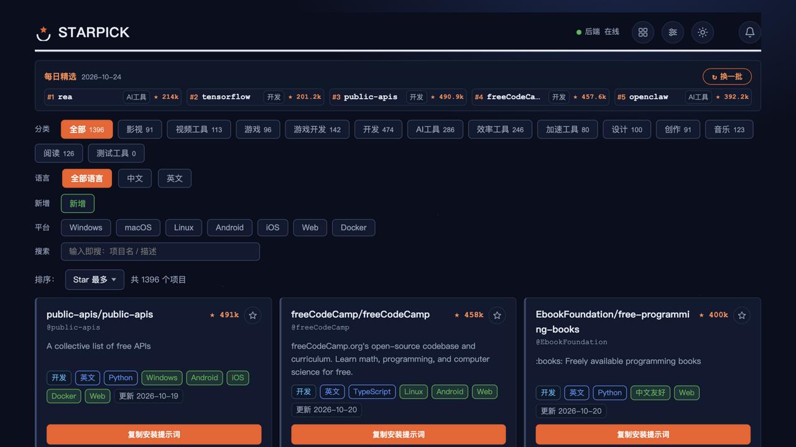
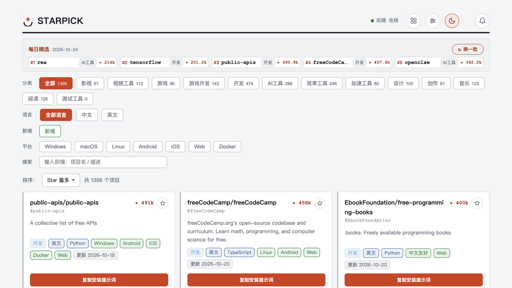
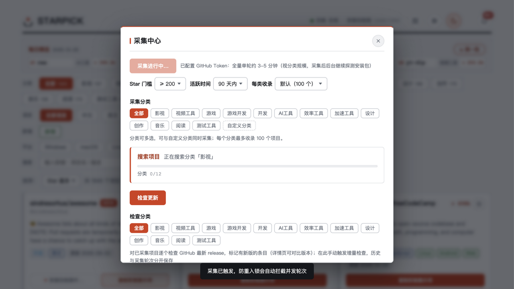
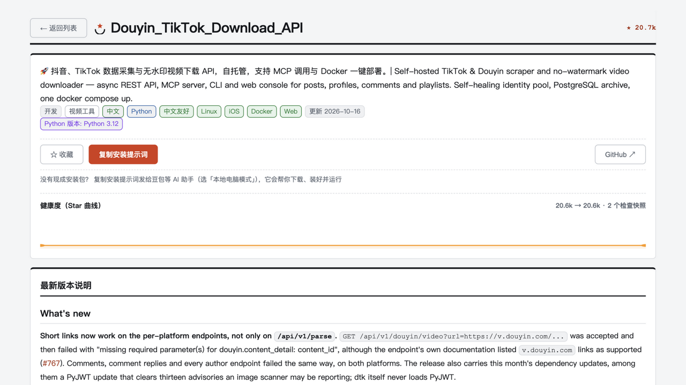
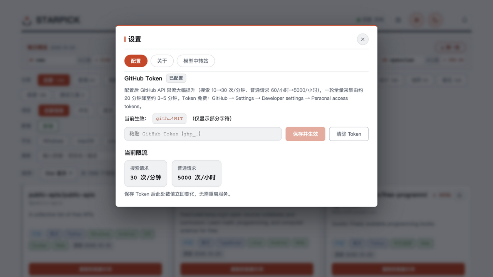

# STARPICK

GitHub is home to hundreds of thousands of great open-source tools, but English UIs, command-line workflows, and uncertain quality keep most people away. **STARPICK browses GitHub for you** — automatically discovering, filtering, translating, and annotating projects, so you can use them like an app store.

An **open-source project discovery and recommendation tool**: browse high-star GitHub projects by category, platform, and language, with automatic Chinese-friendliness ratings, system requirements, and download guidance. Mirror acceleration and one-click install guidance included. A GitHub project directory and open-source software curation list for Chinese-speaking users.

> **Just want to use it?** Grab the installer from [GitHub Releases](https://github.com/Geoff-WSX/starpick/releases/latest) (Windows / macOS, double-click to install).

## Who is it for

**Regular users (no GitHub, no CLI)**
No need to know about repos, releases, or READMEs. Open STARPICK, browse by category, hit "Download" — a video downloader, a screen recorder, a music player, done.

**Chinese-speaking users**
Project descriptions, READMEs, and install guides are processed to be Chinese-readable; the "Chinese" filter shows Chinese-friendly projects (about 430 in the library); multi-language READMEs (71 projects, 366 language versions) switch in one click in the detail view.

**Users with unstable GitHub access**
READMEs, images, and download links automatically use domestic mirror acceleration (gh-proxy.com / ghproxy.net failover) — most of the experience works without a VPN.

**Users wary of fake downloads**
Every project is a real open-source repo with transparent stars, activity, and update history — no bundled installers or download-site tricks.

**Power users / tinkerers**
Trigger discovery or full collection from the Collect Center (with optional star thresholds and activity windows); new projects appear within 30 seconds; define your own categories and keywords to build a personal "open-source radar".

In one sentence: **you don't need to know GitHub — you only need to know the "Download" button.**

## What you can do

- **Browse by category**: movies, video tools, games, game dev, development, AI tools, productivity, acceleration tools, design, creation, music, reading — 12 categories driven by 190 bilingual keywords, with cross-category multi-tags
- **Four-dimensional filtering**: category, language (Chinese/English), platform (Windows/macOS/Linux/Android/iOS/Web/Docker), and new arrivals (last 72h) stack freely; type-to-search (300ms debounce + Enter to search instantly); sort by stars / recent activity / recently added
- **Understand before downloading**: every project shows platform support, system requirements, and Chinese-friendliness; "Download versions" lists all installers prioritized by your current OS (e.g. Kazumi's Windows msix/zip, macOS dmg, Android apk — 9 versions), with mirror-accelerated and original URLs
- **Read details in-app**: full README without leaving GitHub, multi-language one-click switching, images via mirror; package-detection progress visible in real time
- **Favorites & recommendations**: one-click favorite auto-filed by category; daily picks; re-recommendation when stars double
- **You control collection**: manual triggers, per-category collection, optional thresholds; list/filter/search state synced to URL — refresh and share without losing context

## Feature showcase

**Browse** — filter high-star open-source projects by category, language, and platform, with dark-space and light-paper themes.



**Platform & language filters** — filter by Windows / macOS / Linux / Android; one click for Chinese-friendly projects.



**Manual collection** — trigger from the Collect Center with optional star thresholds and activity windows; real-time progress across categories, details, and package probing.



**In-app details** — full README without leaving GitHub; Chinese versions shown by default; multi-language switching.



**Settings** — GitHub Token, one-click self-update, and model relay recommendations in one place.



## Desktop installers (recommended)

**Download: [GitHub Releases latest](https://github.com/Geoff-WSX/starpick/releases/latest)**

| Platform | File | Notes |
|----------|------|-------|
| Windows 10/11 (x64) | `StarPick-1.3-setup.exe` | Double-click install, per-user, no admin |
| macOS (Apple Silicon, 11+) | `StarPick-1.3-arm64.dmg` | Drag into Applications |

- **Data & logs**: macOS `~/Library/Application Support/StarPick/`; Windows `%APPDATA%\StarPick\`. Uninstall keeps your data.
- **Updates**: Settings → About → "Check now"; auto-checks every 6 hours. In-place upgrades keep data.
- **First-run security prompts** (unsigned, expected):
  - macOS: right-click → Open, or System Settings → Privacy & Security → Open Anyway
  - Windows: SmartScreen → "More info" → "Run anyway"
- **GITHUB_TOKEN**: paste in Settings for hot activation (stored in data dir, never written to disk config or DB). Without a token, rate limits are strict (a full round takes 15–30 min); with one, about 3–5 min.

## Quick start (macOS dev mode)

```bash
./start.sh   # creates venv, installs deps, builds frontend, starts and opens browser
```

Manual: install backend deps → build frontend → `python -m uvicorn app.main:app`, visit http://127.0.0.1:8000.

> This repo is the macOS branch (the Windows branch on the old machine evolves independently, see FORK.md).

## Configuration

All in `backend/config.yaml` (restart to apply; invalid config refuses startup):

| Block | Keys | Notes |
| --- | --- | --- |
| `server` | `host` / `port` | Localhost default 127.0.0.1:8000 |
| `schedule` | `discovery_created_hours` / `timezone` | Discovery look-back window and timezone (collection is manual only) |
| `github` | `token_env` / `search_rate_per_minute` / `request_timeout` / `retry_max` / `mirror_enabled` / `mirror_prefixes` | Quotas, timeouts, retries, mirror list |
| `filter` | `min_stars`(200) / `max_inactive_days`(90) / `zh_weight` / `require_zh` | Filter thresholds |
| `dedup` | `re_recommend_on_major_update` / `rounds_retention` | Dedup & re-recommendation |
| `categories` | category name → keyword list | Define search scope, freely editable |

Tokens live only in `backend/.env` (gitignored) or saved from Settings — never in config, never in the DB.

## API overview

| Method | Path | Description |
| --- | --- | --- |
| GET | `/health` | Health check (status / version / last round / token state) |
| GET | `/api/projects` | Project list (`category` / `keyword` / `lang=zh|en` / `new=new` / `zh=1` / `platform=Windows` / `page` / `page_size` / `sort=stars|recent|new`) |
| GET | `/api/projects/{id}` | Project detail (README, multi-language variants, assets) |
| GET | `/api/projects/{id}/similar` | Similar projects (same category, similar star range) |
| GET | `/api/projects/{id}/owner` | Other projects by the same owner |
| GET | `/api/categories` | Category list + per-category project counts |
| GET | `/api/collect/status` | Collection progress snapshot |
| GET | `/api/rounds` / `/api/update-rounds` | Collection / update-check round history |
| GET | `/api/stats` | Stats (total / assets ready / pending / round status) |
| POST | `/api/run` | Trigger a collection round (reentrancy-guarded) |
| POST | `/api/updates/run` | Trigger an incremental update check |
| POST | `/api/categories/cleanup` | Delete projects by category (favorites kept; blocked while collecting) |

## Troubleshooting

| Symptom | Cause & fix |
| --- | --- |
| Page opens but no projects | Menu → Collect Center → "Collect now" for the first round (15–30 min anonymous, 3–5 min with token) |
| Card only shows "Copy install prompt" | Package detection still running — watch "Package detection N/M" in the header; "Download versions" appears when done |
| Log shows `403 rate limit` | Anonymous quota exhausted; the limiter queues automatically — wait for reset or add GITHUB_TOKEN |
| Detail README empty | First collection completes READMEs; startup backfill re-fetches missing ones — wait a few minutes after restart |
| Collection fails but service runs | A failed round doesn't affect the service; reason is in the Collect Center round table |
| Port occupied | Desktop shell picks a free port; dev mode: change `port` in `config.yaml` |

Logs: `logs/kazumi.log` (5MB × 5 rotation, single-line JSON, timestamped).

## Architecture

```
┌─────────────┐    JSON API    ┌──────────────┐
│  Vue3 front │ ────────────▶ │  FastAPI     │
│  (dist)     │ ◀──────────── │  (uvicorn)   │
└─────────────┘                └──────┬───────┘
                                      │
                    ┌─────────────────┼───────────────────┐
                    │                 │                   │
              ┌─────▼─────┐    ┌──────▼──────┐    ┌───────▼──────┐
              │ Collect    │───▶│  Collector  │───▶│   SQLite     │
              │ Center     │    │  pipeline   │    │ (WAL mode)   │
              └───────────┘    └──────┬──────┘    └──────────────┘
                                      │
                            ┌─────────▼─────────┐
                            │  GitHub API client │
                            │ rate-limit/retry/  │
                            │ mirror failover    │
                            └───────────────────┘
```

Three one-way layers: collection writes the DB → API reads the DB → frontend calls the API only. Language tags (zh/en) are determined at ingest time; 181 unit/contract tests.

## Directory layout

```
QuanWangSouSuo/
├── start.sh                # One-click start (macOS)
├── backend/
│   ├── config.yaml         # All tunable config
│   ├── requirements.txt    # Production deps
│   ├── app/
│   │   ├── main.py         # FastAPI entry + routes + scheduler + static hosting
│   │   ├── config.py       # Config load & validation
│   │   ├── db.py           # SQLite (WAL + migrations)
│   │   ├── github_api.py   # GitHub client (rate-limit/retry/mirror failover)
│   │   ├── requirements.py # Platform inference / system requirements / Chinese detection
│   │   ├── collector.py    # Collection pipeline (reentrancy/dedup/concurrency/progress)
│   │   ├── desktop.py      # Desktop shell (pywebview + programmatic uvicorn)
│   │   └── paths.py        # Data/resource path layer (frozen/dev modes)
│   └── tests/              # 181 unit/contract tests
├── frontend/
│   ├── src/                # Vue3 + TS source (list + detail)
│   └── dist/               # Build output (served by backend)
├── packaging/              # Desktop packaging (macOS scripts / Windows CI / Inno)
└── logs/                   # Runtime logs
```

## Development

```bash
# Backend tests (181)
cd backend && python -m pytest tests -q

# Frontend build (must rebuild after frontend changes; backend serves dist/)
cd frontend && npm run build

# Frontend dev mode (hot reload, API proxied to 8000)
cd frontend && npm run dev   # http://localhost:5173
```

## License

MIT
