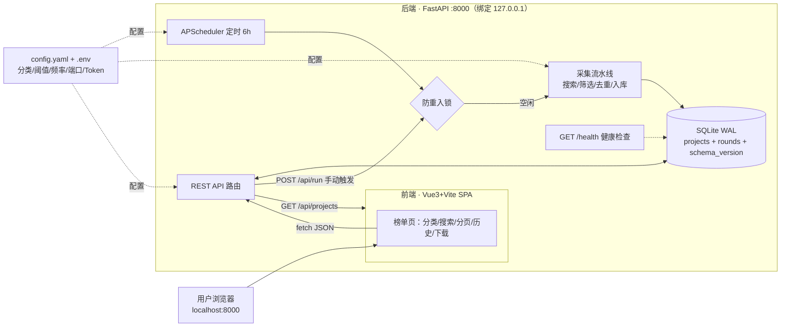

# GitHub 好项目发现器 · 可行性分析报告（定稿）

> 版本：v1.2（并入生产级优化方案，定稿）｜ 日期：2026-10-08 ｜ 状态：需求冻结，已授权开工
> 项目目录：`D:\QuanWangSouSuo`
> 配套文档：`生产级优化方案.md`（已并入本报告第 4、6、7 章）

**版本沿革**：v1.0 静态脚本方案 → v1.1 前后端分离本地 Web 服务（FastAPI + Vue3）→ **v1.2 定稿**（并入生产级优化：容错、可观测、安全、测试四大块，P0 9 项 + P1 7 项全部落地）。

---

## 1. 项目概述

### 1.1 背景

用户日常需要发现并下载 GitHub 上的优质开源项目（影视、游戏、开发工具等）。人工逛 GitHub 效率低，且国内网络环境下直连不稳定。参考此前"下载 Kazumi 追剧工具"的完整闭环（发现 → 评估 → 下载 → 验证），本项目将"发现 + 评估 + 提供下载入口"自动化、批量化、可持续化，以**可交互的本地网站**形态呈现。

### 1.2 项目定位

**生产级、前后端分离的本地 Web 服务**：后端（FastAPI）内置定时调度（默认每 6 小时）自动调用 GitHub 搜索 API，按 7 个分类发现优质公开项目，经筛选、去重后入库（SQLite）；前端（Vue3 + Vite）通过 REST API 提供可交互榜单（分类切换、搜索、分页、历史回看、手动刷新、下载直链与要求标注）。**验收底线：连续 72 小时无人干预；断网/限流/端口冲突下不崩溃、下一轮自动恢复；核心纯函数测试覆盖率 ≥ 80%。**

### 1.3 目标用户与使用场景

| 用户 | 场景 |
|---|---|
| 本项目所有者（个人） | 浏览器访问 `http://localhost:8000` 浏览最新榜单、点击下载、回看历史 |
| 潜在二次使用者 | `start.bat` 一键启动，配置即用，可复制到任意 Windows 机器 |

---

## 2. 需求结论（已确认决策清单）

| 决策点 | 结论 | 状态 |
|---|---|---|
| 运行方式 | 前后端分离本地 Web 服务（FastAPI + uvicorn + APScheduler + Vue3/Vite） | ✅ 已确认 |
| 前端形态 | Vue3 + Vite 标准工程（首次 Node 18+ 构建，产物由后端静态托管） | ✅ 已确认 |
| 定时调度 | 后端内置 APScheduler（BackgroundScheduler，默认每 6 小时，Asia/Shanghai） | ✅ 已确认 |
| 分类范围 | 影视 / 游戏 / 开发 / AI 工具 / 效率工具 / 设计与创作 / 音乐与阅读（7 类，config 可扩） | ✅ 已确认 |
| 筛选标准 | star ≥ 500 + 近 3 个月活跃 + 中文友好优先（三条全开） | ✅ 已确认 |
| 下载功能 | 卡片带下载直链（release 安装包）；标注平台支持与系统要求；无要求不标注 | ✅ 已确认 |
| 交互功能 | 分类切换 / 关键词搜索 / 分页 / 历史回看 / 手动触发采集 | ✅ 已确认 |
| 生产级要求 | 容错（防重入/重试分级/自愈）、可观测（健康检查/日志轮转/失败高亮）、安全（Token 环境化/仅本机绑定）、测试（单测/集成/契约） | ✅ 已确认（本版并入） |

---

## 3. 总体架构与数据流



三层单向依赖：采集层只写库，API 层只读库，前端只调 API。采集期间 API 正常响应。

---

## 4. 环节技术栈分解（含生产化设计）

### 4.1 运行与服务层

| 项 | 选型 | 说明 |
|---|---|---|
| Web 框架 | FastAPI + uvicorn | 异步框架，适配 Vue 前端 JSON API |
| 绑定范围 | `127.0.0.1:8000`（默认，config 可配） | 仅本机访问；局域网访问列入 P2（需鉴权） |
| 启动入口 | `start.bat`（内置崩溃自愈循环） | 进程退出自动重启，连续崩溃 N 次停止并提示；可选"登录时自动启动"任务计划 |
| 资源占用 | 常驻约 60~120MB 内存 | 单机可接受 |

### 4.2 配置层（config.py）

| 项 | 选型 | 说明 |
|---|---|---|
| 配置文件 | `config.yaml`（PyYAML） | 7 类关键词组、筛选阈值、频率、每轮上限、端口、并发数、保留轮数、镜像开关 |
| 密钥管理 | 环境变量 / 本地 `.env`（提供 `.env.example`） | **Token 不入 config、不入库、不分享**；config 仅支持 `${GITHUB_TOKEN}` 引用 |
| 启动校验 | 启动时强校验 | 分类非空、阈值范围、端口未占用、Token 格式合法；错误早失败并输出定位信息 |

### 4.3 采集调度（main.py + collector.py）

| 项 | 选型 | 说明 |
|---|---|---|
| 调度 | APScheduler `BackgroundScheduler` + `CronTrigger` | 后台线程，不阻塞 API；显式 `Asia/Shanghai` 时区 |
| 错过补偿 | `misfire_grace_time=3600` + 启动补跑判断 | 休眠错过调度时容忍并补偿；上次成功距今超 2 周期则启动补跑 |
| **防重入锁（P0-1）** | rounds 表"运行中"任务行 + 文件锁双保险 | 上一轮未完成时跳过本轮并记日志，杜绝并发双轮 |
| 手动触发 | `POST /api/run` | 供前端"立即采集"按钮；同样受防重入锁约束 |

### 4.4 GitHub 采集层（github_api.py）

| 项 | 选型 | 说明 |
|---|---|---|
| 搜索接口 | GitHub REST `Search/Repositories` | `sort=stars`；查询组合：分类关键词 + `stars:>=500` + `pushed:>90天` |
| HTTP 客户端 | Python `requests`，统一 Session | 超时分级（连接/读取）、指数退避 |
| **重试分级（P0-2）** | 429 按 `Retry-After` 等待；5xx/超时退避（上限可配）；401/404 等持久错误立即失败不重试 | 不浪费配额、不错报 |
| 限流控制 | 令牌队列 | 搜索未认证 10 次/分、认证 30 次/分；搜索请求串行排队 |
| **并发抓取（P1-3）** | README/release 二次抓取线程池（默认 6 并发） | 缩短单轮时长；并发数 config 可配 |
| 可选镜像 | gh-proxy.com 等前缀代理 | 直连失败切换通道（config 开关），多通道 failover |

### 4.5 二次采集与标注（github_api.py + requirements.py）

| 项 | 选型 | 说明 |
|---|---|---|
| Release 信息 | REST `Repos/Releases/latest` | 最新版资产文件名与下载直链 |
| README 内容 | `raw.githubusercontent.com` 直取 | 不走 API 配额；失败降级 |
| 平台推断 | 资产扩展名映射 + README 关键词兜底 | `.exe/.msix→Windows`、`.dmg→macOS`、`.apk→Android`、`.ipa→iOS`、`.deb/.AppImage→Linux` |
| 系统要求提取 | README 关键词段落正则（内存/磁盘/GPU/运行时/Docker） | 无匹配则不标注（"无要求不标注"） |
| 中文友好检测 | CJK 字符占比（`[\u4e00-\u9fff]`）+ 关键词双重判定 | 启发式，仅作排序加权 |

### 4.6 质量筛选与排序（collector.py）

| 项 | 选型 | 说明 |
|---|---|---|
| 热度门槛 | `stargazers_count >= 500` | 查询层 + 代码层双重保证 |
| 活跃度 | `pushed_at` 距今 ≤ 90 天 | 排除停更项目 |
| 中文友好 | CJK 占比 > 阈值 或 含"中文/简体中文/汉化" | 排序加权，不排除非中文项目 |
| 结果集 | 每分类 top 5 → 去重后约 30 个/轮 | 可配 |
| 排序 | 综合评分 = 热度（star 对数）+ 活跃加权 + 中文加分 | 权重 config 可调 |
| **再推荐（P1-5）** | config 开关：star 翻倍 / 新 major release 允许重新推荐 | 避免优质项目永久沉底 |

### 4.7 数据层（db.py）

| 项 | 选型 | 说明 |
|---|---|---|
| 数据库 | SQLite 单文件 `history.db`，**WAL 模式 + busy_timeout** | 采集线程写与 API 读并发安全 |
| **Schema 迁移（P0-7）** | `schema_version` 表 + 顺序迁移脚本 | 启动时自动迁移；失败则拒绝启动并提示 |
| 表设计 | `projects`（元数据/平台/要求/下载/中文标识/最近推荐时间）+ `rounds`（轮次/各分类数量/状态/指标摘要） | 支撑榜单查询与历史回看 |
| **保留策略（P1-4）** | rounds 保留最近 N 轮（默认 90）；projects 按 `full_name` 去重更新 | 防库无限膨胀 |

### 4.8 API 层（main.py）

| 项 | 选型 | 说明 |
|---|---|---|
| 路由 | `GET /api/projects`（分类/关键词/分页/排序）、`GET /api/rounds`、`GET /api/projects/{id}`、`POST /api/run`、`GET /api/stats`、**`GET /health`（P0-3：DB 连通+最近轮状态+下轮计划+版本）** | 前端全部数据经 JSON API |
| 静态托管 | FastAPI `StaticFiles` 托管前端 `dist/` | 单端口 8000，无跨域 |
| 数据校验 | Pydantic 响应模型 | 前后端字段契约稳定 |

### 4.9 前端层（frontend/，Vue3 + Vite）

| 项 | 选型 | 说明 |
|---|---|---|
| 框架 | Vue 3（Composition API）+ Vite + TypeScript | 标准工程，组件化 |
| 页面 | 榜单主页（分类 Tab + 搜索防抖 + 分页 + 项目卡片）、历史轮次页（**失败轮次红色高亮（P1-6）**）、项目详情抽屉 | 卡片含平台标签、系统要求、下载按钮 |
| **请求封装（P1-8）** | 统一 fetch 封装：加载骨架 / 错误提示+重试按钮 / 空分类空态 | 生产级 UI 必备 |
| 安全细节 | 外部下载链接新窗口 `rel="noopener noreferrer"`；第三方文本经 Vue 默认转义防 XSS | |
| 构建 | `vite build` 产出静态 `dist/` | 一次性构建后无需 Node；页面 footer 显示版本号 |
| dev/prod 模式 | 开发：vite dev + proxy + 热更新；生产：build + 静态托管（P2-3 文档化） | 两种启动脚本 |

### 4.10 测试与质量保障（P0-8，新增）

| 层 | 技术 | 覆盖 |
|---|---|---|
| 单元测试 | pytest | 筛选打分、平台推断、系统要求提取、中文检测（纯函数） |
| 集成测试 | pytest + mock GitHub API | 模拟正常/429/超时/失败路径，跑通一轮采集入库 |
| 契约测试 | FastAPI TestClient | 各 API 端点响应结构与字段契约 |
| 前端 | Vitest（组件冒烟） | 卡片渲染、请求封装错误分支（可选但建议） |

### 4.11 日志与可观测层（P0-4）

| 项 | 选型 | 说明 |
|---|---|---|
| 日志 | `RotatingFileHandler`（大小轮转 + 保留份数） | 防单文件无限增长 |
| 结构化 | 关键事件单行 JSON（时间/环节/事件/耗时/结果/失败上下文） | 便于排障与脚本分析 |
| 轮次状态 | rounds 表记录成败与指标摘要；失败轮次前端高亮 | 可观测闭环 |

---

## 5. 数据量与资源估算（默认配置）

| 指标 | 估算值 | 计算依据 |
|---|---|---|
| 搜索 API 调用 | 14 次/轮 | 7 分类 × 2 组关键词 |
| 候选项目 | 约 35 个 | 每类 top 5 |
| Release API（core） | 约 30 次/轮 | 去重后每项目 1 次 |
| README 抓取（raw） | 约 30 次/轮 | 不走 API 配额 |
| core API 合计 | 约 32~35 次/轮 | 30 次 release + 兜底 |
| 单轮采集时长 | ≤ 2 分钟（并发抓取后，网络正常） | 原 ≤5 分钟经 P1-3 优化 |
| 服务常驻资源 | 内存 60~120MB，端口 8000 | 本地单机可接受 |

**限流可行性结论**：

| 配置 | 搜索 API | core API | 结论 |
|---|---|---|---|
| 未认证 | 10 次/分 | 60 次/时 | 单轮 35 次 < 60 次/时，默认配置可运行，余量小 |
| 配置 GITHUB_TOKEN | 30 次/分 | 5000 次/时 | 余量充足，支持扩分类与加大每轮数量 |

> 结论：未认证可跑通默认配置；**推荐配置免费 Token**（GitHub 官方个人访问令牌，配置于 `.env`），一次配置长期无忧。

---

## 6. 风险登记与对策（生产级版）

| 编号 | 风险 | 影响 | 概率 | 对策 |
|---|---|---|---|---|
| R1 | 国内直连 GitHub 不稳定 | 采集不完整 | 高 | 超时分级 + 指数退避 + 镜像 failover；README 失败降级"无标注+主页链接" |
| R2 | API 限流（429） | 本轮数据缺失 | 中 | 令牌队列 + Retry-After 等待 + Token 提升配额 + 每轮上限 |
| R3 | 中文识别误判 | 排序偏差 | 中 | CJK 占比 + 关键词双重判定，仅作加权 |
| R4 | 系统要求提取不准 | 卡片信息误导 | 中 | 仅提取结构清晰段落；无匹配不标注；附"以项目页面为准" |
| R5 | 部分项目无 Release | 无下载直链 | 高 | 降级跳转项目主页 |
| R6 | 端口 8000 被占用 | 服务起不来 | 中 | 启动脚本检测并提示；config 可换端口 |
| R7 | 两轮采集并发（调度重入） | 数据错乱/配额超限 | 低 | **防重入锁**（P0-1）跳过运行中任务 |
| R8 | 服务意外退出 | 无法访问 | 低 | **start.bat 自愈循环**（P1-1）+ 可选开机自启 |
| R9 | 机器休眠错过调度 | 漏跑一轮 | 低 | misfire_grace_time + 启动补跑判断（P1-2） |
| R10 | Token 泄漏 | 配额被盗用 | 低 | **Token 仅存 .env**（P0-5），.gitignore 排除 |
| R11 | 表结构演进出错 | 数据损坏 | 低 | **schema_version 迁移**（P0-7），迁移失败拒绝启动 |
| R12 | 配置错误（非法值/坏格式） | 启动即失败 | 中 | **启动强校验**（P1-7），错误定位到具体配置项 |
| R13 | 历史库膨胀 | 查询变慢 | 低 | **保留策略**（P1-4）+ 索引 |
| R14 | 首次构建需 Node 环境 | 上手多一步 | 低 | 仅首次需要 Node 18+；构建产物随项目保留 |

---

## 7. 工作量与实施里程碑（生产级版）

| 里程碑 | 内容 | 验收标准 |
|---|---|---|
| **M1 后端** | collector + github_api + requirements + db（含迁移）+ config（含校验）+ FastAPI 路由（含 /health）+ APScheduler（时区/misfire/防重入锁）+ 日志轮转 + **pytest 基础用例** | `POST /api/run` 跑通一轮入库；`GET /api/projects`、`GET /health` 返回正确；单测通过 |
| **M2 前端** | Vue3+Vite+TS 工程：榜单/搜索/分页/历史（失败高亮）/详情/刷新按钮 + 请求封装（加载/错误/空态）+ rel=noopener | dev 联调后端，交互完整；Vitest 冒烟通过 |
| **M3 端到端试跑** | 真实采集一轮 + 全链路验证 + 故障演练（断网降级/429/端口占用/重复触发防重入） | 7 类分区齐全；平台标注覆盖率 ≥ 80%（有 release 项目）；连续两轮无重复；**测试全绿；故障演练全部通过** |
| **M4 交付定型** | start.bat（自愈）+ 前端 build 托管 + .env.example + README（使用/配置/故障排查） | 单命令启动；浏览器全流程可用；README 覆盖 Token/Node/频率/门槛/常见故障 |

---

## 8. 技术可行性总评

| 维度 | 评估 | 说明 |
|---|---|---|
| 技术成熟度 | ✅ 高 | FastAPI / Vue3 / SQLite / APScheduler 均为成熟主流技术 |
| 数据可得性 | ✅ 高 | 项目元数据、README、Release 均公开接口 |
| 部署成本 | ✅ 低 | 单机服务；`pip install` + 一次 `vite build` |
| 运行成本 | ✅ 低 | 常驻 < 150MB；API < 100 次/轮；Token 免费 |
| 维护成本 | ✅ 低 | 配置集中；三层解耦；测试保障改动安全 |
| 风险可控性 | ✅ 可控 | 14 项风险均有对策，核心链路不阻塞 |

**结论：项目可行，已按生产级标准定稿，建议按 M1→M4 实施。** 外部依赖仅网络连通性、（推荐的）GITHUB_TOKEN 与首次构建的 Node 环境，均在设计与文档中覆盖。

---

## 9. 附件

### 9.1 目标目录结构（生产级版）

```
D:\QuanWangSouSuo\
├─ backend\                  # Python 后端
│  ├─ app\
│  │  ├─ main.py             # FastAPI 入口 + APScheduler + 静态托管 + /health
│  │  ├─ collector.py        # 采集流水线（防重入/筛选/排序/入库）
│  │  ├─ github_api.py       # GitHub API 封装（搜索/README/Release/重试分级/镜像）
│  │  ├─ requirements.py     # 系统要求提取 + 平台推断 + 中文检测
│  │  ├─ db.py               # SQLite（WAL/迁移/projects/rounds）
│  │  └─ config.py           # config.yaml 加载 + 启动校验
│  ├─ tests\                 # pytest：单元/集成/契约
│  ├─ config.yaml
│  ├─ requirements.txt       # 锁定版本
│  ├─ requirements-dev.txt   # pytest 等
│  ├─ .env.example           # GITHUB_TOKEN 模板（.env 不入库）
│  └─ history.db             # 自动生成
├─ frontend\                 # Vue3 + Vite + TS 工程
│  ├─ src\                   # views / components / api / types
│  └─ vite.config.ts         # dev proxy → localhost:8000
├─ start.bat                 # 一键启动（自愈循环 + 静态托管 dist）
├─ logs\
├─ docs\
├─ .gitignore                # 排除 .env/history.db/logs/dist
└─ README.md                 # 使用/配置/故障排查
```

### 9.2 分类关键词组初稿（实现时写入 config.yaml）

影视（追剧/播放器/字幕/视频下载）、游戏（模拟器/Mod/汉化/服务器）、开发（CLI/自托管/效率/框架）、AI 工具（LLM/Agent/RAG/AI 绘画）、效率工具（笔记/剪贴板/密码管理/自动化）、设计与创作（图标/字体/壁纸/海报）、音乐与阅读（音乐下载/电子书/阅读器/RSS）
